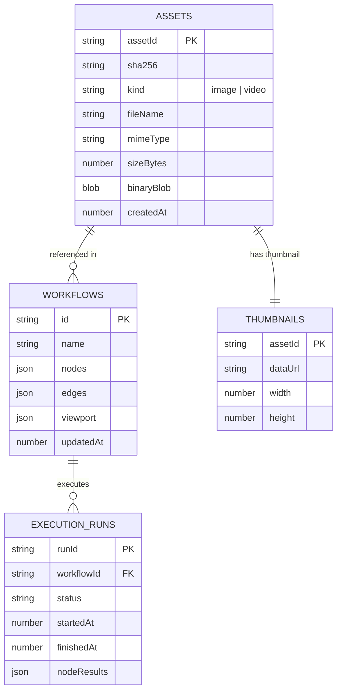

# FlowOps — Muse AI Workflow Studio System Architecture

## 1. Executive Architecture Summary

**Muse AI Workflow Studio** is a local-first, node-based visual studio designed for iterative image and video generation through browser automation on `https://muse.ai/`.

Inspired by the visual density and interaction paradigms of TobyFlow and modern creative studios, the system operates across three distinct zones on the user's local machine:
1. **Web Application Zone (`apps/web`)**: A high-density `@xyflow/react` Dark UI canvas with node drag-and-drop, parameter configuration, topological DAG execution engine, and IndexedDB (`Dexie.js`) local-first Blob storage.
2. **Chrome Extension Zone (`extension/`)**: A Manifest V3 background service worker providing tab discovery, keepalive heartbeats, and chunked binary transfer relays.
3. **Muse AI Tab Zone (`https://muse.ai/`)**: The user's active, authenticated browser tab injected with a TypeScript Content Script DOM adapter that drives composer uploads via `DataTransfer`, fills prompts via native React property setters, tracks generation lifecycles via `MutationObserver`, and extracts binary media blobs via same-origin fetch.

---

## 2. System Architecture Diagram

```mermaid
flowchart TB
    subgraph LocalMachine["User Personal Machine (Existing Chrome Profile)"]
        subgraph WebAppZone["1. Muse Workflow Studio (Web App - Next.js/React + TypeScript)"]
            UI["Workflow Canvas UI\n(@xyflow/react + Dark Obsidian/Warm Stone)"]
            PAL["Node Palette & Config Inspector\n(Input, References, Generation, Output)"]
            ENG["DAG Workflow Execution Engine\n(Topological Sort, Single-Tab Mutex, AbortController)"]
            STORE["Zustand Workflow Store"]
            IDB[("IndexedDB (Dexie.js)\n- workflows\n- assets (Blobs)\n- thumbnails (WebP)\n- executionRuns")]
            BRIDGE_CLIENT["Extension Bridge Client\n(Port & 256KB Chunked Relay)"]
        end

        subgraph ExtensionZone["2. Muse Runner Chrome Extension (Manifest V3)"]
            EXT_CONN["Externally Connectable Listener\n(Origin Allowlist Check)"]
            SW_ROUTER["Background Service Worker\n(Keepalive Manager & Router)"]
            TAB_MGR["Muse Tab Coordinator\n(Find Existing Tab / Open Tab)"]
            CHUNK_RELAY["Binary Chunk Relay Buffer"]
        end

        subgraph MuseTabZone["3. Tab https://muse.ai/ (Authenticated User Session)"]
            CS_ADAPTER["Muse Content Script Adapter\n(DOM Controller & Job Tracker)"]
            DOM_OBSERVER["MutationObserver & State Monitor\n(Pre-Submit Snapshot & Stop Button Watch)"]
            MUSE_UI["Muse AI Web UI (Hatch)\n[data-hatch-composer-root]\n[data-message-item]"]
        end
    end

    UI <--> STORE
    PAL <--> STORE
    STORE <--> ENG
    ENG <--> IDB
    UI <--> IDB
    ENG <--> BRIDGE_CLIENT

    BRIDGE_CLIENT <==>|"chrome.runtime.connect\n(externally_connectable Port)"| EXT_CONN
    EXT_CONN <--> SW_ROUTER
    SW_ROUTER <--> TAB_MGR
    SW_ROUTER <--> CHUNK_RELAY

    SW_ROUTER <==>|"chrome.tabs.connect\n(Content Script Port)"| CS_ADAPTER
    CS_ADAPTER <--> DOM_OBSERVER
    CS_ADAPTER <-->|"DataTransfer Upload /\nNative Setter / Fetch Media"| MUSE_UI
    DOM_OBSERVER <-->|"Inspect DOM Changes"| MUSE_UI
```

---

## 3. Data Contracts & Domain Boundaries

### 3.1 Typed Node Port Hierarchy
To ensure strict correctness and prevent pipeline failures, ports enforce typed connections:
- `imageOut` → emits `ImageAssetRef[]` (supports up to 9 references per Muse AI limits).
- `promptOut` → emits `PromptText`.
- `imagesIn` → receives `ImageAssetRef[]` from Image Nodes or upstream Output Nodes.
- `promptIn` → receives `PromptText` from Prompt Nodes.
- `resultOut` → emits `MediaAssetRef` from Muse AI Node.
- `mediaIn` → receives `MediaAssetRef` on Output Node.
- `mediaPassthroughOut` → re-emits `MediaAssetRef` as image/video reference for downstream Muse AI nodes (Round-trip chaining).

### 3.2 9-Phase Muse Execution Lifecycle
When a `Muse AI Node` executes, its progress reflects the real-world browser automation state:
1. `Connecting`: Establishing port handshake with Chrome Extension.
2. `Checking Login`: Verifying authenticated session on `https://muse.ai/`.
3. `Uploading Images`: Chunking and injecting reference images into the composer's hidden file input via `DataTransfer`.
4. `Preparing Prompt`: Setting prompt text via native prototype value setter.
5. `Submitting`: Dispatching Submit / Enter action and taking pre-submit DOM snapshot.
6. `Generating`: Monitoring progress counter and tracking `[data-testid="hatch-composer-stop-button"]`.
7. `Collecting Result`: Isolating newly created assistant message, fetching media Blob via same-origin fetch, and slicing into 256KB binary chunks.
8. `Saving Asset`: Reassembling chunks in Web App and writing to IndexedDB.
9. `Completed`: Node execution succeeded; preview and downstream ports active.

---

## 4. Local-First Storage Architecture (`Dexie.js`)

