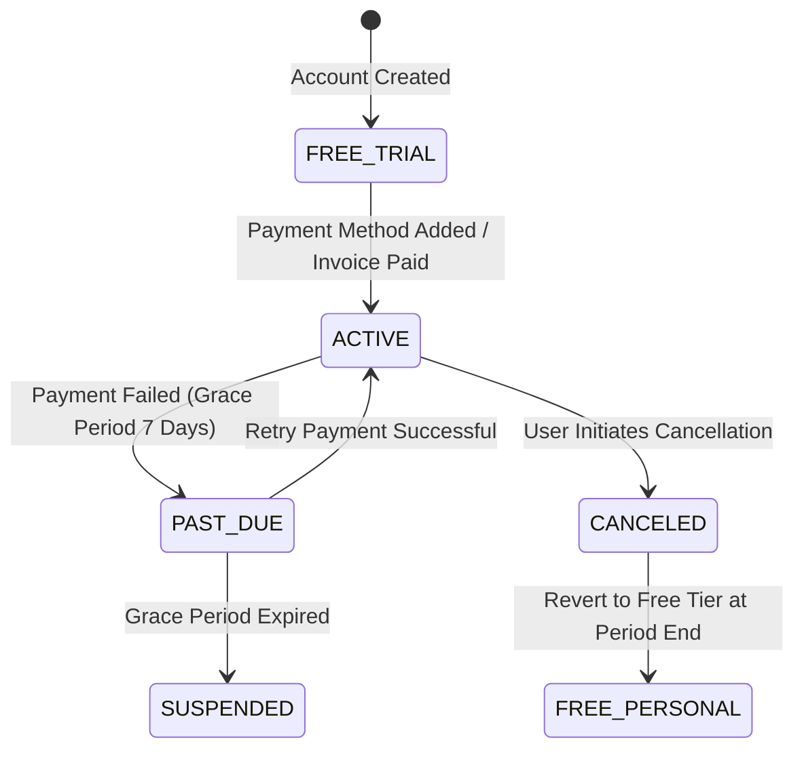

# FlowOps Billing Architecture & Provider Abstraction

FlowOps implements a robust, honest billing architecture that abstracts underlying payment processors while maintaining transparent subscription lifecycle management.

---

## 1. Design Principles & Anti-Pattern Rejection

FlowOps adheres strictly to truth-in-billing engineering:
1. **No Fake Transactions**: The platform never pretends a real card charge occurred when a gateway is unconfigured or in sandbox mode.
2. **Provider Agnostic Abstraction**: FlowOps defines a clean `BillingGatewayProvider` interface that adapts to Stripe, LemonSqueezy, or mock local billing providers.
3. **Explicit Sandbox State**: When operating locally or without live gateway keys, the UI clearly displays:
   `"Billing Provider Status: Sandbox / Development Mode — No real charges will be processed."`

---

## 2. Subscription Lifecycle

---

## 3. Webhook Ingestion & Idempotency

All incoming billing webhooks (`POST /api/v1/billing/webhooks`) are verified via cryptographic signature matching and processed through an idempotency cache:
- `invoice.paid`: Transitions subscription to `ACTIVE` and extends the billing period.
- `invoice.payment_failed`: Transitions status to `PAST_DUE` and sends email notifications.
- `customer.subscription.deleted`: Reverts the organization's plan tier to `FREE_PERSONAL`, locking workflows exceeding the 2-workflow quota into read-only archive status.
