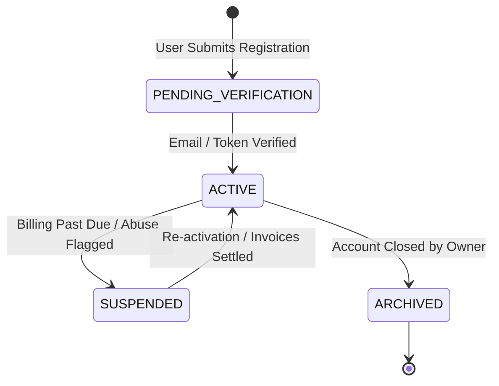

# FlowOps Account Models & Tenant Hierarchy

FlowOps supports three distinct account paradigms designed to scale from individual engineers to global enterprise organizations.

---

## 1. Tenant Model Architecture

```
                    Platform Administrator (Superadmin)
                                   │
                 ┌─────────────────┴─────────────────┐
                 │                                   │
       Individual Account                   Organization Account
     (Developer / Free Tier)                (Multi-Seat Tenant)
                 │                                   │
        Personal Workspace                   Enterprise Tenant
                 │                         ┌─────────┴─────────┐
        Workflows (Max: 2)             Project Alpha       Project Beta
                                           │                   │
                                       Workflows           Workflows
```

---

## 2. Account Categories

### 2.1 Individual Account (`INDIVIDUAL`)
- **Target Audience**: Solo engineers, cloud architects, indie hackers, exploratory evaluators.
- **Hierarchy**: One user, one default personal workspace.
- **Entitlement Tier**: Bound to `FREE_PERSONAL` plan.
- **Quotas**:
  - Maximum Active Workflows: **2** (Strictly enforced at API gateway).
  - Monthly Workflow Executions: **1,000**.
  - S3 Execution Artifact Retention: **7 days**.
  - Maximum Nodes per Workflow: **25**.
  - Collaboration: Read-only public link generation with token masking.
- **Billing**: Always $0 / month. No credit card required.

### 2.2 Organization Account (`ORGANIZATION`)
- **Target Audience**: Startups, engineering departments, enterprise cross-functional teams.
- **Hierarchy**: Multi-user tenant containing multiple Projects.
- **Entitlement Tiers**:
  - `ORG_STARTER` ($49/month): 25 workflows, 10,000 runs/mo, 5 seats, 30-day retention.
  - `ORG_PRO` ($199/month): 250 workflows, 100,000 runs/mo, 20 seats, 90-day retention, Priority support.
  - `ORG_ENTERPRISE` (Custom): Unlimited workflows, VPC peering, dedicated Step Functions execution roles.
- **Features**:
  - Shared credentials and connection pools with project-level isolation.
  - Granular Role-Based Access Control (`OWNER`, `ADMIN`, `MEMBER`, `BILLING`).
  - Unified billing with honest payment provider integration.

### 2.3 Platform Administrator (`PLATFORM_ADMIN`)
- **Target Audience**: FlowOps core operations, infrastructure security engineers, system administrators.
- **Access Route**: Dedicated administrative portal at `/diix`.
- **Security Boundaries**:
  - Cannot be created via public `/signup` or self-serve invitation.
  - Governed by explicit `SUPERADMIN` authorization flags.
  - Capabilities:
    - Global multi-tenant overview (active tenants, total workflow executions, system health).
    - Organization lifecycle management (suspend, activate, inspect quotas).
    - Plan and entitlement catalog configuration.
    - Immutable platform audit event stream inspection.

---

## 3. Account Lifecycle & State Machine


