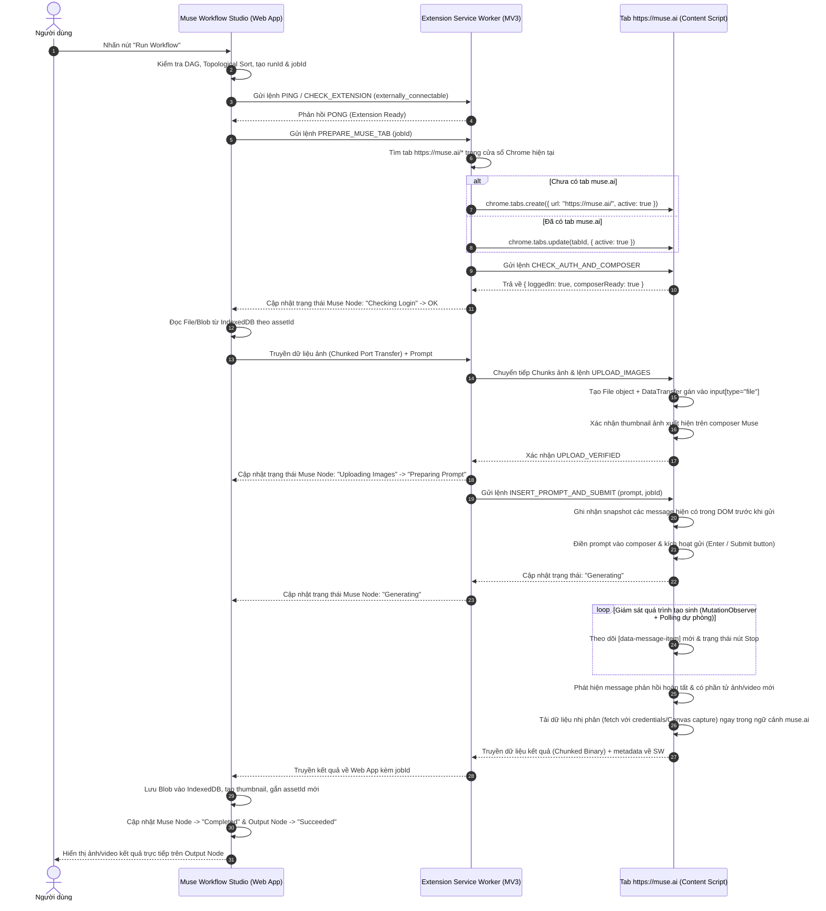

# 02 — Bản đồ Tương tác Người dùng và Luồng Dữ liệu (TobyFlow Interaction Map)

**Ngày kiểm tra dữ liệu:** 2026-11-16  
**Nguồn tham chiếu:** [Trang chủ TobyFlow](https://tobyflow.com/), [Tài liệu Hướng dẫn TobyFlow](https://tobyflow.com/guide), [Thư viện Workflow TobyFlow](https://tobyflow.com/workflows), [MuseFlow (26Flow) trên GitHub](https://github.com/bynne2602/museflow), và [Muse-Chat-MCP trên GitHub](https://github.com/duclm1x1/Muse-Chat-MCP).

## 1. Bản đồ Tương tác của Người dùng trên Canvas (User Interaction Flow)

* **[FACT]** Theo mục *Workflow Builder — How to Use* trên [Tài liệu Hướng dẫn TobyFlow](https://tobyflow.com/guide) và tài liệu của [MuseFlow (26Flow)](https://github.com/bynne2602/museflow), vòng đời thao tác của người dùng từ lúc thiết kế đến khi nhận kết quả gồm 5 giai đoạn tuần tự:
  1. **Khởi tạo Canvas:** Mở trình soạn thảo Workflow và tạo workflow mới (`Create New`) hoặc khôi phục từ bản lưu cục bộ.
  2. **Kéo thả Node từ Palette:** Kéo các khối chức năng (`Image`, `Prompt`, `Muse`, `Output`) từ thanh công cụ bên trái thả vào vị trí mong muốn trên mặt phẳng tọa độ `(x, y)` của Canvas.
  3. **Cấu hình Dữ liệu từng Node:**
     * Trên `Image Node`: Nhấp chọn tệp từ ổ cứng, kéo thả (Drag & Drop) tệp ảnh vào khung node, hoặc dán (`Ctrl+V`) từ Clipboard.
     * Trên `Prompt Node`: Nhập mô tả cảnh, ánh sáng, bố cục, và có thể chèn thẻ tham chiếu `@ref` / `@node`.
     * Trên `Muse AI Node`: Chọn chế độ đầu ra dự kiến (`Image` hoặc `Video`) và cấu hình bổ sung (nếu được xác minh trên tài khoản Muse).
  4. **Thiết lập Kết nối (Wiring Edges):** Kéo chuột từ cổng `Output Port` ở cạnh phải của node nguồn sang cổng `Input Port` tương thích ở cạnh trái của node đích.
  5. **Kích hoạt Thực thi & Giám sát:** Nhấn nút `Run` trên thanh công cụ chính (hoặc chạy riêng từng nhánh). Theo dõi tiến trình trực tiếp trên cả hai cửa sổ: cửa sổ Canvas và tab `https://muse.ai/` trên trình duyệt Chrome hiện có ([MuseFlow (26Flow)](https://github.com/bynne2602/museflow)).

```mermaid
flowchart LR
    subgraph UserActions["1. Thao tác Người dùng trên Canvas"]
        A["Kéo thả Image, Prompt, Muse, Output Node"] --> B["Upload ảnh từ máy tính vào Image Node"]
        B --> C["Nhập nội dung văn bản vào Prompt Node"]
        C --> D["Kéo dây nối (Edges) giữa các Port tương thích"]
        D --> E["Nhấn nút Run Workflow (Manual Trigger)"]
    end

    subgraph EngineValidation["2. Kiểm tra & Lập lịch (Web App)"]
        E --> F["Kiểm tra DAG (Không chu trình, đủ Input)"]
        F --> G["Sắp xếp Topological Sort & Đẩy vào Queue"]
        G --> H["Truy xuất Blob ảnh từ IndexedDB"]
    end

    subgraph BrowserExecution["3. Thực thi trên Chrome Hiện có"]
        H --> I["Gửi lệnh qua Extension Bridge"]
        I --> J["Tìm/Mở tab muse.ai & Kiểm tra Login"]
        J --> K["Đính kèm File vào input[type=file] & Điền Prompt"]
        K --> L["Nhấn gửi (Submit) & Quan sát DOM chờ kết quả"]
    end

    subgraph ResultReturn["4. Thu thập & Hiển thị Kết quả"]
        L --> M["Trích xuất Media thực tế (Blob/Binary)"]
        M --> N["Truyền ngược về Web App & Lưu IndexedDB"]
        N --> O["Cập nhật Muse Node & Hiển thị trên Output Node"]
    end
```



## 2. Cơ chế Node Nhận và Truyền Dữ liệu (Data Propagation Map)

### 2.1. Phân tách Dữ liệu Hiển thị (View State) và Dữ liệu Thực thi (Execution Payload)
* **[INFERENCE]** & **[RECOMMENDATION]** Để giữ cho Canvas phản hồi tức thì khi kéo thả hàng chục node chứa ảnh độ phân giải cao, hệ thống tách biệt hoàn toàn 2 tầng dữ liệu:

| Tầng dữ liệu | Nơi lưu trữ | Nội dung chứa bên trong | Mục đích sử dụng |
| :--- | :--- | :--- | :--- |
| **View State (Trên Node UI)** | Bộ nhớ RAM của Zustand / React Flow (`node.data`) | `assetId` (UUID), `fileName`, `mimeType`, `fileSize`, `width`, `height`, và `thumbnailDataUrl` (ảnh thu nhỏ nén WebP/JPEG kích thước tối đa `320px`, dung lượng `< 25KB`). | Hiển thị tức thì trên thẻ node, lưu vào JSON cấu trúc workflow mà không làm phình bộ nhớ. |
| **Execution Payload (Khi chạy Workflow)** | Lưu bền vững trong `IndexedDB` (`assets` store) | Đối tượng `Blob` nhị phân nguyên bản của ảnh gốc người dùng tải lên hoặc ảnh/video kết quả thu về từ Muse AI. | Được Workflow Engine đọc ra theo `assetId` ngay tại thời điểm `Muse AI Node` bắt đầu bước `Uploading Images`. |

### 2.2. Luồng Truyền Dữ liệu qua các Kết nối (Single-Step & Multi-Step Chaining)
* **[OBSERVATION]** Trong TobyFlow ([Trang chủ TobyFlow](https://tobyflow.com/)) và [MuseFlow (26Flow)](https://github.com/bynne2602/museflow), dữ liệu đi theo hướng có hướng (Directed Edge) từ trái sang phải:
  1. **Luồng Đơn bước (Basic Pipeline):**
     * `Image Node` phát ra đối tượng tham chiếu `ImageAssetRef` (chứa `assetId`) tại cổng `imageOut`.
     * `Prompt Node` phát ra chuỗi `PromptText` tại cổng `promptOut`.
     * `Muse AI Node` gom toàn bộ `ImageAssetRef[]` nối vào cổng `imagesIn` (hỗ trợ nhiều ảnh tham chiếu khi kết nối nhiều `Image Node` vào cùng một cổng) và `PromptText` tại cổng `promptIn`.
     * Sau khi tab `muse.ai` hoàn tất tạo sinh, `Muse AI Node` lưu kết quả mới vào `IndexedDB` với `resultAssetId` mới, rồi phát `MediaAssetRef` ra cổng `resultOut`.
     * `Output Node` nhận `MediaAssetRef` tại cổng `mediaIn`, hiển thị bản xem trước, cho phép tải xuống máy tính (`Download`) hoặc sao chép (`Copy`).
  2. **Luồng Đa bước (Multi-Step Chaining — Tái sử dụng Kết quả):**
     * **[RECOMMENDATION]** Cổng đầu ra `mediaPassthroughOut` của `Output Node 1` (hoặc cổng `resultOut` của `Muse AI Node 1`) có cùng kiểu dữ liệu `ImageAssetRef` / `MediaAssetRef` với đầu ra của `Image Node`.
     * Khi người dùng kéo dây từ `Output Node 1` sang cổng `imagesIn` của `Muse AI Node 2`, `Muse AI Node 2` sẽ tự động chờ `Output Node 1` chuyển sang trạng thái `Succeeded`, lấy đúng `Blob` ảnh vừa tạo ở bước 1 trong `IndexedDB` và upload ảnh đó lên giao diện `muse.ai` cho bước 2 cùng với `Prompt Node 2` và `Image Node 2`.

```mermaid
flowchart LR
    IMG1["Image Node 1\n(assetId: img_01)"] -->|imageOut| MUSE1["Muse AI Node 1\n(Bước 1: Tạo ảnh gốc)"]
    PRM1["Prompt Node 1\n(Prompt cảnh 1)"] -->|promptOut| MUSE1
    MUSE1 -->|resultOut\n(assetId: res_01)| OUT1["Output Node 1\n(Preview & Lưu res_01)"]

    OUT1 -->|mediaPassthroughOut\n(assetId: res_01)| MUSE2["Muse AI Node 2\n(Bước 2: Biến đổi / Chuyển cảnh)"]
    IMG2["Image Node 2\n(assetId: img_02)"] -->|imageOut| MUSE2
    PRM2["Prompt Node 2\n(Prompt cảnh 2)"] -->|promptOut| MUSE2
    MUSE2 -->|resultOut\n(assetId: res_02)| OUT2["Output Node 2\n(Kết quả cuối res_02)"]
```

## 3. Bản đồ Tương tác Khi Chạy Workflow và Thu thập Kết quả (Execution & Return Sequence)

Dưới đây là trình tự tương tác chi tiết giữa 4 thực thể (**Người dùng**, **Web Application**, **Chrome Extension Service Worker**, và **Muse Content Script trên tab `muse.ai`**) trong suốt một chu kỳ chạy:



## 4. Tương tác Xử lý Tình huống Ngoại lệ (Exception Interaction Map)

* **[FACT]** & **[RECOMMENDATION]** Dựa trên kinh nghiệm vận hành thực tế được ghi nhận trong [Tài liệu Hướng dẫn TobyFlow](https://tobyflow.com/guide), [MuseFlow (26Flow)](https://github.com/bynne2602/museflow), và [Muse-Chat-MCP](https://github.com/duclm1x1/Muse-Chat-MCP), bản đồ tương tác khi xảy ra ngoại lệ được quy định như sau:
  1. **Người dùng chưa đăng nhập `muse.ai`:** Content Script phát hiện thiếu vùng nhập liệu `[data-hatch-composer-root]` hoặc API kiểm tra phiên trả về chưa xác thực. Hệ thống chuyển trạng thái node sang `Paused (Waiting for Login)`, hiển thị thông báo rõ ràng trên Web App để người dùng tự đăng nhập trên tab Chrome vừa mở, sau đó nhấn `Resume` / `Retry`.
  2. **Muse hiển thị hộp thoại xác nhận quyền (Approval Card) hoặc Captcha:** Theo [Báo cáo thực nghiệm Muse AI trên Note.com](https://note.com/uponconsulting/n/n13e08f4c7c0b?hl=en) và [Muse-Chat-MCP](https://github.com/duclm1x1/Muse-Chat-MCP), Muse có thể tạm dừng và hiển thị thẻ xác nhận (`needsApproval: true`). Hệ thống **tuyệt đối không tự ý bấm vượt qua bảo mật/captcha** mà phát cảnh báo lên giao diện để người dùng chủ động kiểm tra trên tab Chrome.
  3. **Muse từ chối tạo nội dung do bộ lọc chính sách (Refusal Message):** Theo tài liệu của [MuseFlow (26Flow)](https://github.com/bynne2602/museflow), Muse có thể trả về tin nhắn văn bản từ chối (bằng tiếng Việt hoặc tiếng Anh) mà không sinh ra media. Khi phát hiện phản hồi kết thúc chỉ có văn bản từ chối và không có media, Content Script trả về mã lỗi `MUSE_GENERATION_DECLINED` kèm nguyên văn thông báo của Muse để hiển thị ngay trên `Muse AI Node`, đồng thời dừng các node phụ thuộc phía sau (`Blocked` / `Cancelled`).
