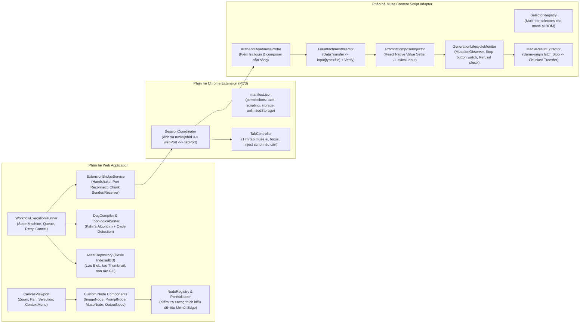
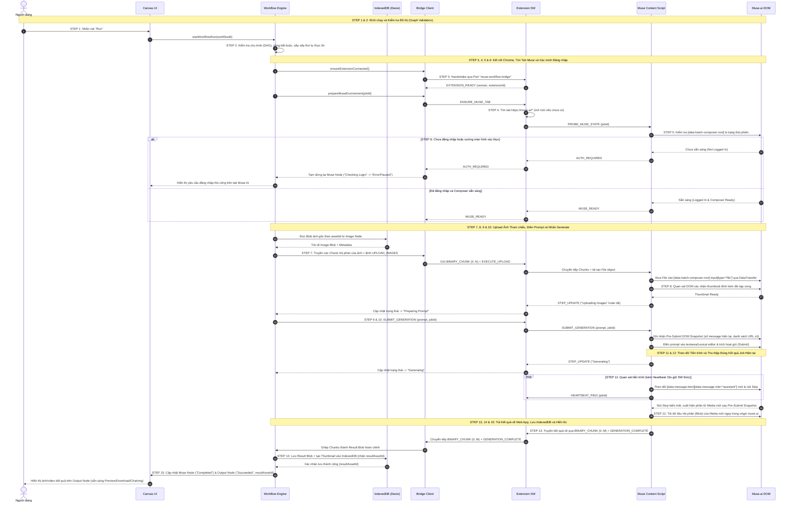
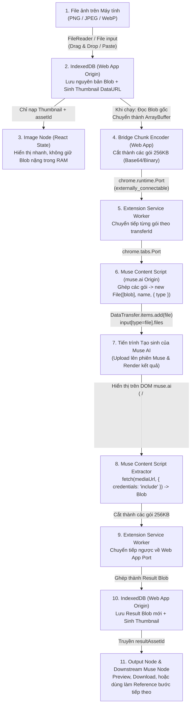
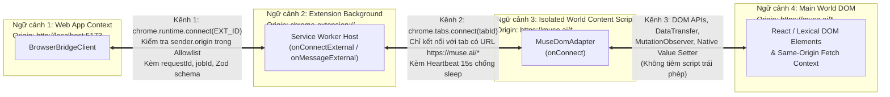

# 04 — Kiến trúc Tổng thể Hệ thống Muse Workflow Studio (System Architecture)

**Ngày kiểm tra dữ liệu:** 2026-11-16  
**Phạm vi thiết kế:** Hệ thống Web Application kết hợp Chrome Extension Manifest V3 điều khiển phiên đăng nhập `https://muse.ai/` trên trình duyệt Chrome hiện có của người dùng, hoàn toàn không sử dụng API key hay máy chủ AI riêng.

## 1. Sơ đồ Kiến trúc Tổng thể Hệ thống (System Architecture Diagram)

Hệ thống **Muse Workflow Studio** được chia thành 3 vùng thực thi độc lập nhưng liên kết chặt chẽ ngay trên máy tính cá nhân của người dùng (**Local-First Architecture**):
1. **Vùng 1 — Muse Workflow Studio Web App (`http://localhost:5173`):** Nơi người dùng thiết kế workflow trên Canvas, quản lý kho tài nguyên cục bộ trong `IndexedDB`, và điều phối thứ tự thực thi DAG.
2. **Vùng 2 — Muse Runner Chrome Extension (Manifest V3):** Đóng vai trò cầu nối được cấp quyền tối thiểu, kiểm soát tab Chrome và vận chuyển gói tin điều khiển cũng như luồng nhị phân chia nhỏ (Chunked Binary Transfer).
3. **Vùng 3 — Tab `https://muse.ai/` trên Chrome Hiện có:** Chứa phiên đăng nhập sẵn có của người dùng và `Muse Content Script Adapter` trực tiếp tương tác với DOM của Muse AI.

```mermaid
flowchart TB
    subgraph LocalMachine["Máy tính Cá nhân của Người dùng (Existing Chrome Profile)"]
        subgraph WebAppZone["1. Muse Workflow Studio (Web Application - React + TypeScript)"]
            UI["Workflow Canvas UI\n(@xyflow/react + Dark Theme)"]
            PAL["Node Palette & Config Panel\n(Image, Prompt, Muse, Output)"]
            ENG["DAG Workflow Engine\n(Topological Sort, Scheduler, AbortController)"]
            STORE["State Management\n(Zustand Store)"]
            IDB[("IndexedDB (Dexie.js)\n- workflows\n- assets (Blobs)\n- thumbnails\n- executionLogs")]
            BRIDGE_CLIENT["Browser Bridge Client\n(Port & Chunked Binary Stream)"]
        end

        subgraph ExtensionZone["2. Muse Runner Chrome Extension (Manifest V3)"]
            EXT_CONN["Externally Connectable Listener\n(Origin Allowlist Check)"]
            SW_ROUTER["Background Service Worker\n(Message Router & Keepalive Manager)"]
            TAB_MGR["Muse Tab Manager\n(Find Existing Tab / Open Tab)"]
            CHUNK_RELAY["Binary Chunk Relay Buffer"]
        end

        subgraph MuseTabZone["3. Tab https://muse.ai/ (Signed-in User Session)"]
            CS_ADAPTER["Muse Content Script Adapter\n(DOM Controller & Job Tracker)"]
            DOM_OBSERVER["MutationObserver + Polling Fallback\n(Pre-Submit Snapshot & Result Detector)"]
            MUSE_UI["Giao diện Web Muse AI (Hatch)\n[data-hatch-composer-root]\n[data-message-item]"]
        end
    end

    UI <--> STORE
    PAL <--> STORE
    STORE <--> ENG
    ENG <--> IDB
    UI <--> IDB
    ENG <--> BRIDGE_CLIENT

    BRIDGE_CLIENT <==>|"chrome.runtime.connect\n(externally_connectable Port)"| EXT_CONN
    EXT_CONN <--> SW_ROUTER
    SW_ROUTER <--> TAB_MGR
    SW_ROUTER <--> CHUNK_RELAY

    SW_ROUTER <==>|"chrome.tabs.connect\n(Content Script Port)"| CS_ADAPTER
    CS_ADAPTER <--> DOM_OBSERVER
    CS_ADAPTER <-->|"DataTransfer Upload /\nNative Setter / Fetch Media"| MUSE_UI
    DOM_OBSERVER <-->|"Quan sát DOM"| MUSE_UI
```

## 2. Sơ đồ Thành phần Chi tiết (Component Diagram)

Mỗi phân hệ được tách thành các mô-đun đơn nhiệm (Single Responsibility) để AI Coding Agent có thể lập trình và viết kiểm thử độc lập:

## 3. Sơ đồ Trình tự Thực thi Chi tiết (End-to-End Sequence Diagram)

Sơ đồ dưới đây mô tả luồng thực thi chuẩn 15 bước (từ `STEP 1` đến `STEP 15` theo yêu cầu thiết kế) cho một chu kỳ chạy hoàn chỉnh:

## 4. Sơ đồ Luồng Dữ liệu Vòng khép kín (Data Flow Diagram — Image Round Trip)

Sơ đồ dưới đây thể hiện chính xác cách dữ liệu biến đổi định dạng khi đi từ ổ cứng máy tính qua từng ranh giới bảo mật của trình duyệt và quay trở lại `Output Node`:

## 5. Sơ đồ Giao tiếp Giữa các Ngữ cảnh Trình duyệt (Browser Communication Diagram)

Trong Chrome, Web Application, Extension Service Worker, và Content Script chạy trong 3 ngữ cảnh cô lập khác nhau. Sơ đồ dưới đây quy định rõ giao thức và cơ chế bảo vệ ở từng ranh giới:

