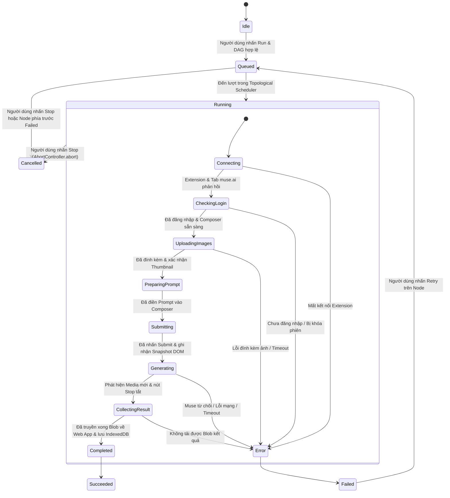

# 06 — Thiết kế Workflow Engine, DAG Scheduler và Data Contracts (Workflow Engine)

**Ngày kiểm tra dữ liệu:** 2026-11-16  
**Nguồn tham chiếu:** [Tài liệu Hướng dẫn TobyFlow](https://tobyflow.com/guide), [MuseFlow (26Flow) trên GitHub](https://github.com/bynne2602/museflow), và [Muse-Chat-MCP trên GitHub](https://github.com/duclm1x1/Muse-Chat-MCP).

## 1. Nguyên tắc Thiết kế Workflow Engine Độc lập Giao diện (UI-Agnostic Engine)

`WorkflowEngine` được thiết kế thành một lớp TypeScript thuần (`src/engine/WorkflowEngine.ts`), hoàn toàn không phụ thuộc vào React компонента hay DOM của Canvas:
* Giao diện React (`@xyflow/react`) chỉ đọc trạng thái từ store và phát lệnh (`runWorkflow`, `stopWorkflow`, `retryNode`, `resetWorkflow`).
* Engine nhận vào bản chụp đồ thị (`WorkflowGraphSnapshot` gồm `nodes[]` và `edges[]`), kiểm tra tính hợp lệ của đồ thị có hướng không chu trình (**Directed Acyclic Graph — DAG**), lập lịch thực thi, và phát sự kiện cập nhật trạng thái qua giao diện `WorkflowEngineCallbacks`.

## 2. Hệ thống TypeScript Data Contracts Toàn diện

Dưới đây là bộ hợp đồng dữ liệu TypeScript đầy đủ cho các kiểu dữ liệu miền (`PromptText`, `ImageAsset`, `MediaAsset`, `GenerationResult`, `ExecutionStatus`), cấu trúc `Node` / `Edge`, và giao thức thông điệp giữa Web App với Chrome Extension:

```typescript
// ============================================================================
// 1. KIỂU DỮ LIỆU CỐT LÕI (CORE DOMAIN TYPES)
// ============================================================================

export type NodeId = string;
export type EdgeId = string;
export type AssetId = string;
export type RunId = string;
export type JobId = string;

export type NodeType = 'image' | 'prompt' | 'muse' | 'output';

export type ExecutionStatus =
  | 'Idle'
  | 'Queued'
  | 'Running'
  | 'Succeeded'
  | 'Failed'
  | 'Cancelled';

export type MuseExecutionPhase =
  | 'Idle'
  | 'Connecting'
  | 'Checking Login'
  | 'Uploading Images'
  | 'Preparing Prompt'
  | 'Submitting'
  | 'Generating'
  | 'Collecting Result'
  | 'Completed'
  | 'Error';

export interface PromptText {
  kind: 'PromptText';
  text: string;
  resolvedFromNodes: NodeId[];
  characterCount: number;
}

export interface ImageAsset {
  kind: 'ImageAsset';
  assetId: AssetId;
  fileName: string;
  mimeType: 'image/png' | 'image/jpeg' | 'image/webp';
  sizeBytes: number;
  width: number;
  height: number;
  sha256: string;
  createdAt: number;
  source: 'user_upload' | 'clipboard_paste' | 'muse_output';
}

export interface MediaAsset {
  kind: 'MediaAsset';
  assetId: AssetId;
  mediaType: 'image' | 'video';
  fileName: string;
  mimeType: 'image/png' | 'image/jpeg' | 'image/webp' | 'video/mp4' | 'video/webm';
  sizeBytes: number;
  width?: number;
  height?: number;
  durationSeconds?: number;
  sourceJobId?: JobId;
  originalMuseUrl?: string;
  createdAt: number;
}

export interface GenerationResult {
  kind: 'GenerationResult';
  jobId: JobId;
  runId: RunId;
  nodeId: NodeId;
  mediaAsset: MediaAsset;
  assistantMessageText?: string;
  startedAt: number;
  completedAt: number;
  elapsedMs: number;
}

// ============================================================================
// 2. HỢP ĐỒNG NODE VÀ EDGE (GRAPH CONTRACTS)
// ============================================================================

export interface NodeExecutionMetadata {
  runId?: RunId;
  jobId?: JobId;
  musePhase?: MuseExecutionPhase;
  startedAt?: number;
   finishedAt?: number;
  elapsedMs?: number;
  attemptCount: number;
  errorCode?: string;
  errorMessage?: string;
}

export interface WorkflowNode<
  TConfig = Record<string, unknown>,
  TInputs = Record<string, unknown>,
  TOutputs = Record<string, unknown>
> {
  id: NodeId;
  type: NodeType;
  position: { x: number; y: number };
  config: TConfig;
  inputs: TInputs;
  outputs: TOutputs;
  status: ExecutionStatus;
  executionMetadata: NodeExecutionMetadata;
}

export type SourcePortName = 'imageOut' | 'promptOut' | 'resultOut' | 'mediaPassthroughOut';
export type TargetPortName = 'contextIn' | 'promptIn' | 'imagesIn' | 'mediaIn';

export interface WorkflowEdge {
  id: EdgeId;
  sourceNodeId: NodeId;
  sourcePort: SourcePortName;
  targetNodeId: NodeId;
  targetPort: TargetPortName;
}

// ============================================================================
// 3. HỢP ĐỒNG THÔNG ĐIỆP WEB APP <-> CHROME EXTENSION <-> CONTENT SCRIPT
// ============================================================================

export type BridgeMessageType =
  | 'PING'
  | 'PONG'
  | 'PREPARE_MUSE_TAB'
  | 'MUSE_TAB_STATUS'
  | 'BINARY_TRANSFER_INIT'
  | 'BINARY_TRANSFER_CHUNK'
  | 'BINARY_TRANSFER_COMPLETE'
  | 'EXECUTE_MUSE_JOB'
  | 'MUSE_JOB_PHASE_UPDATE'
  | 'MUSE_JOB_RESULT_READY'
  | 'MUSE_JOB_ERROR'
  | 'CANCEL_MUSE_JOB'
  | 'HEARTBEAT_KEEPALIVE';

export interface BridgeMessageEnvelope<TPayload = unknown> {
  protocolVersion: '1.0';
  requestId: string;
  runId: RunId;
  jobId: JobId;
  timestamp: number;
  type: BridgeMessageType;
  payload: TPayload;
}

export interface BinaryTransferInitPayload {
  transferId: string;
  direction: 'upload_to_muse' | 'result_from_muse';
  assetId: AssetId;
  fileName: string;
  mimeType: string;
  totalBytes: number;
  chunkSizeBytes: number;
  totalChunks: number;
}

export interface BinaryTransferChunkPayload {
  transferId: string;
  chunkIndex: number;
  totalChunks: number;
  base64Data: string;
}
```

## 3. Thuật toán Thực thi Đồ thị Có hướng Không Chu trình (DAG Execution Engine)

### 3.1. Kiểm tra Chu trình và Sắp xếp Tô-pô (Topological Sorting bằng Thuật toán Kahn)
Không cho phép đồ thị có vòng lặp (cycle) trong MVP:
1. **Tính bậc vào (`inDegree`):** Với mỗi node $u \in V$, đếm số cạnh $(v \to u) \in E$.
2. **Khởi tạo hàng đợi gốc ($Q$):** Đưa tất cả các node có `inDegree[u] === 0` vào hàng đợi $Q$.
3. **Duyệt Kahn:**
   * Lấy từng node $u$ ra khỏi $Q$, đưa vào danh sách thứ tự thực thi `executionOrder.push(u)`.
   * Với mỗi cạnh nối từ $u$ sang $w$, giảm `inDegree[w]` đi 1. Nếu `inDegree[w] === 0`, đưa $w$ vào $Q$.
4. **Phát hiện vòng lặp:** Nếu `executionOrder.length < V.length`, đồ thị tồn tại chu trình khép kín. Engine lập tức từ chối chạy và trả về lỗi `DAG_CYCLE_DETECTED` kèm danh sách các node nằm trong vòng lặp.

### 3.2. Kiểm tra Tính Hợp lệ của Đầu vào (Static & Pre-Run Input Validation)
Trước khi gửi bất kỳ lệnh nào tới trình duyệt Chrome, Engine thực hiện kiểm tra tĩnh:
* Mọi `Muse AI Node` nằm trong nhánh thực thi phải có đúng 1 kết nối vào cổng `promptIn` từ một `Prompt Node` có nội dung khác rỗng (`rawText.trim().length > 0`).
* Mọi `Image Node` được nối vào `Muse AI Node` phải có ít nhất 1 `assetId` hợp lệ tồn tại trong `IndexedDB`, và tổng số ảnh tham chiếu đầu vào của một `Muse AI Node` không vượt quá `9` ảnh ([useapi.net Muse API Spec](https://useapi.net/docs/api-muse-v1)).
* Mọi `Output Node` phải được nối vào cổng `resultOut` của một `Muse AI Node`.

### 3.3. Cơ chế Điều phối Hàng đợi Tuần tự cho Tab Muse Duy nhất (Single-Tab Mutex Queue)
* **[FACT]** Theo tài liệu kỹ thuật của [Muse-Chat-MCP](https://github.com/duclm1x1/Muse-Chat-MCP) (*"Serialized — one browser, requests run one at a time (auto-queued)"*), một phiên đăng nhập `https://muse.ai/` trên một trình duyệt thực thi một yêu cầu tạo sinh tại một thời điểm trên composer.
* **[RECOMMENDATION]** Do đó, trong `WorkflowEngine`:
  * Các node nội bộ không dùng trình duyệt (`Image Node`, `Prompt Node`, `Output Node`) có thể giải quyết phụ thuộc tức thì trong bộ nhớ.
  * Các `Muse AI Node` (dù nằm trên hai nhánh song song của DAG) sẽ đi qua một **Browser Execution Mutex Queue (`concurrency = 1`)** theo đúng thứ tự Tô-pô. Nhờ vậy, `Muse AI Node 2` chỉ bắt đầu nạp ảnh và điền prompt lên tab `muse.ai` sau khi `Muse AI Node 1` đã thu thập xong kết quả.



### 3.4. Lan truyền Kết quả, Lan truyền Lỗi, Hủy và Thử lại (Propagation, Cancellation & Retry)
1. **Result Propagation (Lan truyền Kết quả):**
   * Khi node $u$ hoàn tất (`Succeeded`), Engine đọc toàn bộ các cạnh đi ra từ $u$ (`edge.sourceNodeId === u.id`).
   * Giá trị tại `u.outputs[edge.sourcePort]` được chép sang `targetNode.inputs[edge.targetPort]` (nếu cổng đích là `imagesIn`, các mảng `ImageAssetRef` từ nhiều cạnh được gộp theo thứ tự kết nối).
2. **Error Propagation (Lan truyền Lỗi):**
   * Khi một node $u$ chuyển sang `Failed`, Engine duyệt BFS/DFS toàn bộ các node hậu duệ phụ thuộc vào $u$ và chuyển trạng thái của chúng từ `Queued` sang `Cancelled` với lý do `UPSTREAM_NODE_FAILED`, đồng thời giữ nguyên kết quả của các node phía trước đã `Succeeded`.
3. **Cancellation (Hủy chủ động bằng `AbortController`):**
   * Mỗi lượt chạy workflow khởi tạo một `AbortController` gắn với `runId`.
   * Khi người dùng nhấn `Stop`, Engine gọi `abortController.abort()`, gửi ngay gói tin `CANCEL_MUSE_JOB` qua Extension tới Content Script. Content Script trên tab `muse.ai` kiểm tra nếu nút `[data-testid="hatch-composer-stop-button"]` đang hiển thị thì nhấp vào để dừng tạo sinh trên Muse, sau đó giải phóng khóa hàng đợi.
4. **Partial Retry (Thử lại từ Node bị lỗi):**
   * Khi một `Muse AI Node` ở bước 2 bị lỗi (`Failed`) nhưng bước 1 đã thành công (`Succeeded`), người dùng có thể nhấn `Retry` ngay trên `Muse AI Node 2`. Engine tái sử dụng luôn `resultAssetId` đã lưu trong `IndexedDB` của bước 1 mà không cần chạy lại bước 1.
