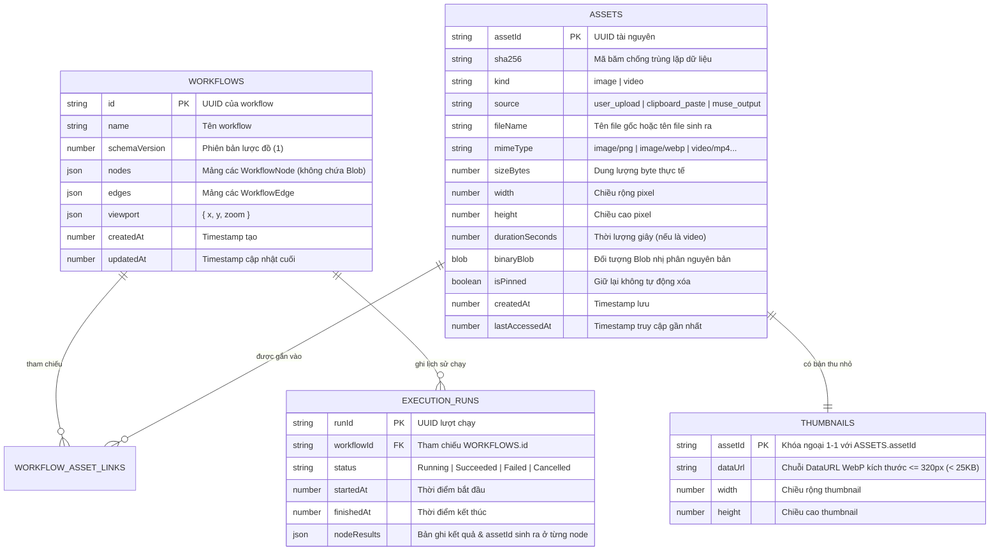

# 07 — Thiết kế Lưu trữ Cục bộ và Quản lý File (Local-First Data Storage)

**Ngày kiểm tra dữ liệu:** 2026-11-16  
**Nguồn tham chiếu:** [Chính sách Quyền riêng tư TobyLabs](https://labs.toby.vn/privacy) và [Chrome-Stats TobyFlow](https://chrome-stats.com/d/iicjfgdnngmpfocfanpiammedafmomin).

## 1. Triết lý Lưu trữ Local-First và Lý do Chọn IndexedDB + Dexie.js

* **[FACT]** Theo Mục 2.1 của [Chính sách Quyền riêng tư TobyLabs](https://labs.toby.vn/privacy), TobyFlow lưu trữ toàn bộ workflow, lịch sử tạo sinh, ảnh tham chiếu (albums/thumbnails) và bộ nhớ đệm tệp tải lên trực tiếp trên máy tính người dùng qua `IndexedDB` và `chrome.storage.local`.
* **[RECOMMENDATION]** Vì **Muse Workflow Studio** là ứng dụng Web chạy trên máy cá nhân và không sử dụng Cloud Storage trong MVP:
  * **Tuyệt đối không dùng `localStorage`** để lưu ảnh hoặc cấu trúc workflow có chứa media vì `localStorage` bị giới hạn cứng `5MB` mỗi origin và chỉ lưu được chuỗi đồng bộ (làm đơ luồng giao diện chính).
  * **Sử dụng `IndexedDB` thông qua thư viện `Dexie.js`:** Hỗ trợ lưu trữ đối tượng nhị phân nguyên bản (`Blob` / `ArrayBuffer`) dung lượng hàng gigabyte, truy vấn theo chỉ mục (index), hỗ trợ giao dịch nguyên tử (atomic transactions) và tích hợp sẵn hook phản ứng (`useLiveQuery`) cho React.

## 2. Thiết kế Lược đồ Cơ sở Dữ liệu IndexedDB (`MuseStudioDatabase`)

Cơ sở dữ liệu `MuseWorkflowStudioDB` trong `IndexedDB` gồm 4 bảng (object stores) tách biệt rõ ràng giữa **Cấu trúc Đồ thị (Graph Metadata)**, **Tài nguyên Nhị phân Gốc (Binary Blobs)**, **Ảnh Thu nhỏ (Thumbnail Cache)**, và **Lịch sử Thực thi (Execution History)**:



### Khai báo Lược đồ TypeScript với `Dexie.js`
```typescript
import Dexie, { type Table } from 'dexie';

export interface StoredWorkflowRecord {
  id: string;
  name: string;
  schemaVersion: 1;
  nodes: SerializedWorkflowNode[];
  edges: WorkflowEdge[];
  viewport: { x: number; y: number; zoom: number };
  createdAt: number;
  updatedAt: number;
}

export interface StoredAssetRecord {
  assetId: string;
  sha256: string;
  kind: 'image' | 'video';
  source: 'user_upload' | 'clipboard_paste' | 'muse_output';
  fileName: string;
  mimeType: string;
  sizeBytes: number;
  width?: number;
  height?: number;
  durationSeconds?: number;
  binaryBlob: Blob;
  isPinned: boolean;
  createdAt: number;
  lastAccessedAt: number;
}

export interface StoredThumbnailRecord {
  assetId: string;
  dataUrl: string;
  width: number;
  height: number;
}

export interface StoredExecutionRunRecord {
  runId: string;
  workflowId: string;
  status: 'Running' | 'Succeeded' | 'Failed' | 'Cancelled';
  startedAt: number;
  finishedAt?: number;
  nodeLogs: Array<{
    nodeId: string;
    status: string;
    outputAssetId?: string;
    errorMessage?: string;
  }>;
}

export class MuseStudioDatabase extends Dexie {
  workflows!: Table<StoredWorkflowRecord, string>;
  assets!: Table<StoredAssetRecord, string>;
  thumbnails!: Table<StoredThumbnailRecord, string>;
  executionRuns!: Table<StoredExecutionRunRecord, string>;

  constructor() {
    super('MuseWorkflowStudioDB');
    this.version(1).stores({
      workflows: 'id, name, updatedAt',
      assets: 'assetId, sha256, kind, source, createdAt, lastAccessedAt, isPinned',
      thumbnails: 'assetId',
      executionRuns: 'runId, workflowId, status, startedAt',
    });
  }
}
```

## 3. Quy tắc Xử lý Blob URL, Chống Mất Dữ liệu Khi Reload và Chống Trùng lặp

### 3.1. Tại sao Cấm Lưu `blob:http://...` làm Đường dẫn Cố định?
* Đường dẫn tạo bởi `URL.createObjectURL(blob)` (ví dụ `blob:http://localhost:5173/550e8400-...`) chỉ là một con trỏ bộ nhớ tạm thời gắn với tài liệu `document` hiện tại. Ngay khi người dùng nhấn `F5` (Reload) hoặc đóng tab, trình duyệt thu hồi toàn bộ bảng ánh xạ `blob:` đó, khiến mọi thẻ `` lưu chuỗi `blob:` bị lỗi ảnh gãy (`ERR_FILE_NOT_FOUND`).
* **Giải pháp chuẩn trong Muse Workflow Studio:**
  1. Trong cấu hình của `Image Node` và `Output Node` lưu trong bảng `workflows`, **chỉ lưu mã định danh `assetId` cố định** kèm `thumbnailDataUrl` (chuỗi `data:image/webp;base64,...` cực nhẹ lấy từ bảng `thumbnails`).
  2. Khi người dùng mở xem trước độ phân giải gốc (Full Preview) hoặc phát video trên `Output Node`, một React hook chuyên dụng `useAssetObjectUrl(assetId)` sẽ đọc `binaryBlob` từ bảng `assets` trong `IndexedDB`, gọi `URL.createObjectURL(binaryBlob)` khi component mount và tự động gọi `URL.revokeObjectURL(url)` trong hàm dọn dẹp `useEffect` khi component unmount để chống rò rỉ bộ nhớ RAM (Memory Leak).

### 3.2. Chống Trùng lặp Nội dung bằng Mã băm SHA-256 (Content-Addressed Deduplication)
* Khi người dùng tải cùng một bức ảnh nhân vật lên nhiều `Image Node` khác nhau, trước khi ghi vào bảng `assets`, hệ thống tính mã băm `SHA-256` của `ArrayBuffer` bằng Web Crypto API (`crypto.subtle.digest('SHA-256', buffer)`).
* Nếu trong bảng `assets` đã tồn tại bản ghi có cùng mã `sha256`, hệ thống trả về luôn `assetId` hiện có và cập nhật `lastAccessedAt` mà không ghi lặp lại `Blob` thứ hai.

### 3.3. Tự động Lưu và Khôi phục Trạng thái (Workflow Persistence & Export/Import)
* **Autosave khi chỉnh sửa Canvas:** Mọi thao tác thêm/xóa/di chuyển node, nối dây, sửa prompt đều được debounce `400ms` và ghi xuống bản ghi `workflows` hiện tại trong `IndexedDB`. Khi người dùng reload trang (`F5`), ứng dụng tự động nạp lại workflow vừa mở gần nhất (`ORDER BY updatedAt DESC LIMIT 1`) cùng toàn bộ ảnh đã upload và kết quả đã sinh.
* **Xuất / Nhập File Dự án (`.museflow.json`):** Học hỏi tính năng *Save workflow / Import workflow* của [MuseFlow (26Flow)](https://github.com/bynne2602/museflow), người dùng có thể xuất toàn bộ workflow (gồm cấu trúc node/edge và tùy chọn nhúng các asset đầu vào) ra file `.museflow.json` để sao lưu trên ổ cứng.

## 4. Quản lý Dung lượng và Thu gom Rác (Quota Management & Garbage Collection)

1. **Yêu cầu Lưu trữ Bền vững (`Persistent Storage`):**
   * Khi khởi động ứng dụng lần đầu, gọi `navigator.storage.persist()` để yêu cầu trình duyệt Chrome không tự động xóa `IndexedDB` khi ổ cứng thiếu dung lượng.
2. **Giám sát Dung lượng Thời gian thực:**
   * Hiển thị thanh chỉ báo dung lượng lưu trữ cục bộ ở góc dưới thanh trạng thái bằng `navigator.storage.estimate()` (hiển thị tổng số MB đang dùng bởi `assets` và số lượng tệp đang lưu).
3. **Cơ chế Xóa Asset Mồ côi (Orphaned Asset Garbage Collection):**
   * Một `assetId` được coi là **đang được tham chiếu (Referenced)** nếu nó nằm trong:
     * Bất kỳ `Image Node` (`config.items[].assetId`) hoặc `Output Node` / `Muse AI Node` (`outputs.resultOut.assetId`) của bất kỳ bản ghi nào trong bảng `workflows`, **HOẶC**
     * Có cờ `isPinned === true`.
   * Hệ thống cung cấp nút **"Dọn dẹp tài nguyên không dùng (Clean Unused Assets)"** trong bảng quản lý bộ nhớ (và tác vụ kiểm tra định kỳ các tài nguyên tạm quá hạn) để xóa các bản ghi `assets` và `thumbnails` không còn thuộc bất kỳ workflow nào.
